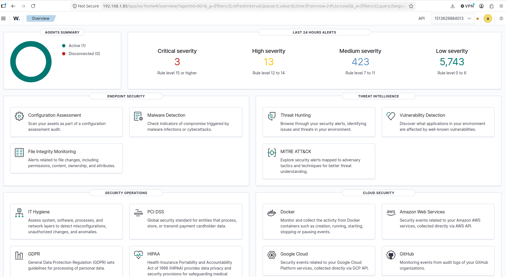

# Wazuh SIEM Homelab — SOC Portfolio

> A hands-on Security Operations Center (SOC) lab built to simulate and detect real-world attacks using Wazuh SIEM/XDR, Sysmon, and Kali Linux.


---

## Dashboard



---

## Overview

This lab simulates a real-world SOC environment where attacks are launched from a Kali Linux machine, detected by Wazuh, and investigated through the dashboard. The goal is to demonstrate practical SOC analyst skills including alert triage, log analysis, custom rule writing, and MITRE ATT&CK mapping.

---

## Three Attack Scenarios Detected

| # | Attack | MITRE Technique | Severity |
|---|--------|----------------|----------|
| 1 | Mimikatz — Credential Dumping | T1003 | Critical |
| 2 | Brute Force — Failed Logons | T1110 | High |
| 3 | Metasploit Reverse Shell — Full Kill Chain | T1059 | High |

---

## Lab Architecture

```
┌─────────────────────────────────────────────────────────┐
│                     HOME NETWORK                        │
│                   192.168.1.0/24                        │
│                                                         │
│  ┌──────────────────────┐    ┌───────────────────────┐  │
│  │     Mac Mini         │    │   Windows 11 Laptop   │  │
│  │  Ubuntu 22.04        │    │   (MSI) - Endpoint    │  │
│  │  192.168.1.85        │    │   192.168.1.235       │  │
│  │                      │    │                       │  │
│  │  ┌────────────────┐  │    │  ┌─────────────────┐  │  │
│  │  │ Wazuh Manager  │◄─┼────┼──│  Wazuh Agent    │  │  │
│  │  │ Wazuh Indexer  │  │    │  │  Sysmon         │  │  │
│  │  │ Wazuh Dashboard│  │    │  └─────────────────┘  │  │
│  │  │ (Docker)       │  │    │                       │  │
│  │  └────────────────┘  │    │  ┌─────────────────┐  │  │
│  └──────────────────────┘    │  │ Kali Linux (VM) │  │  │
│                              │  │ 192.168.1.99    │  │  │
│                              │  │ Attacker        │  │  │
│                              │  └─────────────────┘  │  │
│                              └───────────────────────┘  │
└─────────────────────────────────────────────────────────┘
```

---

## Documentation

| Page | Description |
|------|-------------|
| [Architecture](docs/architecture.md) | Lab setup, components, and network configuration |
| [Attack Scenarios](docs/attack-scenarios.md) | Step-by-step attack simulations with screenshots |
| [Detection Rules](docs/detection-rules.md) | Custom Wazuh rules written for this lab |
| [MITRE & Compliance](docs/mitre-compliance.md) | ATT&CK mapping and PCI-DSS / HIPAA coverage |

---

## Tech Stack

| Tool | Role |
|------|------|
| Wazuh 4.14.5 | SIEM / XDR Platform |
| Docker Compose | Container orchestration |
| Ubuntu 22.04 | SIEM server OS |
| Windows 11 | Monitored endpoint |
| Sysmon (SwiftOnSecurity) | Endpoint telemetry |
| Kali Linux | Attack simulation |
| Metasploit | Exploit framework |
| Mimikatz | Credential dumping simulation |

---

## Skills Demonstrated

| Category | Skills |
|----------|--------|
| SOC Operations | Alert triage, log analysis, threat hunting |
| Detection Engineering | Custom Wazuh rules, MITRE ATT&CK mapping |
| Endpoint Security | Sysmon deployment, Windows Event Log analysis |
| Offensive Security | Metasploit, Mimikatz, Nmap, Hydra |
| Infrastructure | Docker, Linux administration, network configuration |

---

## Author

**Stefano van Tongeren** — Cyber Security student, Hogeschool van Amsterdam  
[GitHub](https://github.com/STongeren) · [LinkedIn](https://www.linkedin.com/in/stongeren/)

> *Built entirely from scratch as a self-learning project to develop practical SOC analyst skills.*

---

> **Disclaimer:** All attack simulations were performed in a controlled, isolated lab environment on systems I own. For educational purposes only.
